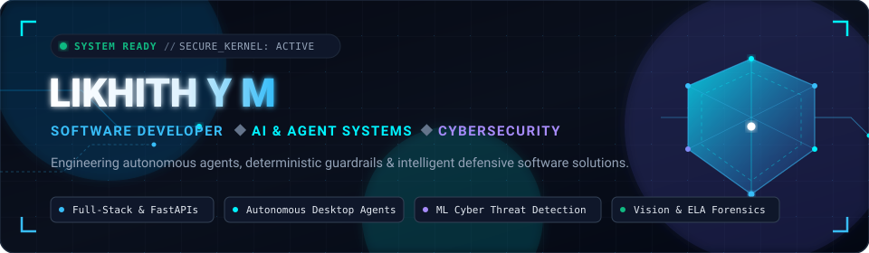
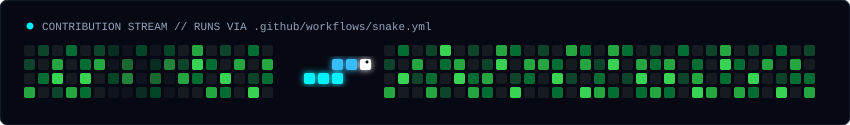

<!-- HERO BANNER -->

 

<!-- DYNAMIC TYPING SVG -->

  
  
  
  

---

###  Quick Bio

I'm **Likhith Y M**, a Computer Science undergrad building full-stack applications, deterministic local AI agent runtimes, and defensive cybersecurity tools.

-  **Full-Stack Engineering**: Developing responsive web apps and APIs with React 19, FastAPI, Flask, and Vite.
-  **Local AI & Autonomous Agents**: Implementing deterministic guardrails and out-of-band execution kernels for local SLMs (Ollama, Qwen2.5, Gemma-3).
-  **Cybersecurity & Forensics**: Real-time ML threat detection (Isolation Forest, WebSockets) and image tampering verification (ELA & SSIM).

---

###  Pinned Projects

<!-- DYNAMIC GITHUB REPO CARDS (auto-updates stars, forks, and language) -->

  
  
   
  
  

 

| Project | Summary | Stack | Links |
| :--- | :--- | :--- | :--- |
| **[Yojak](https://github.com/LikhithYM/Yojak)** | Deterministic out-of-band security kernel preventing tool misuse in autonomous desktop agents | `Python` `FastAPI` `React` `Ollama` | [Code](https://github.com/LikhithYM/Yojak) |
| **[NeuroSent](https://github.com/LikhithYM/NeuroSent)** | Real-time cyber threat detection engine streaming ML anomaly predictions to a live SOC UI | `Python` `FastAPI` `scikit-learn` `D3.js` | [Code](https://github.com/LikhithYM/NeuroSent) |
| **[AuthentiCert](https://github.com/LikhithYM/AuthentiCert)** | Credential verification platform combining OCR with Error Level Analysis (ELA) forensics | `React 19` `Flask` `OpenCV` `Tesseract` | [Code](https://github.com/LikhithYM/AuthentiCert) |
| **[Career Path Visualizer](https://github.com/LikhithYM/career-path-visualizer)** | Interactive academic roadmap tree navigator with embedded Google Gemini career assistant | `React 19` `Vite` `Tailwind` `Gemini API` | [Live Demo](https://careerpathvisualizer.netlify.app/) · [Code](https://github.com/LikhithYM/career-path-visualizer) |

<b> Click to expand: Architecture & Technical Details</b>

 

- **Yojak**: Decouples cognitive planning from execution authorization. High-risk actions (file operations, shell executions) trigger a human-in-the-loop modal with live screen captures. Sub-2ms deterministic rule overhead optimized for local SLMs (Qwen2.5-Coder-7B). NOTE: This is a private repository and it is a research based project and am still working on it
- **NeuroSent**: Multi-model ML pipeline using Isolation Forest for zero-day anomalies, Random Forest for known attack vectors (DDoS, brute-force, SQLi), and WebSocket streaming into a D3.js interactive SOC dashboard.
- **AuthentiCert**: Automated credential validation using PyTesseract/PyMuPDF extraction, Error Level Analysis (ELA) to detect digital tampering/spliced text, and SSIM layout comparison against baseline templates.
- **Career Path Visualizer**: Graph canvas built with ReactFlow, smooth branch centering, dark/light theme switching with Framer Motion, and conversational Gemini API integration with prompt guardrails.

---

###  Tech Stack

<table width="100%">
  <tr>
    <td width="22%"><b>Languages</b></td>
    <td>
      
      
      
      
      
    </td>
  </tr>
  <tr>
    <td><b>Frontend & UI</b></td>
    <td>
      
      
      
      
    </td>
  </tr>
  <tr>
    <td><b>Backend & APIs</b></td>
    <td>
      
      
      
      
    </td>
  </tr>
  <tr>
    <td><b>AI, ML & Vision</b></td>
    <td>
      
      
      
      
      
    </td>
  </tr>
  <tr>
    <td><b>Security & Tooling</b></td>
    <td>
      
      
      
      
    </td>
  </tr>
</table>

---

###  Live GitHub Activity

  
  &nbsp;
  

  

<!-- Dynamic Contribution Snake -->
<picture>
  <source media="(prefers-color-scheme: dark)" srcset="https://raw.githubusercontent.com/LikhithYM/LikhithYM/output/github-contribution-grid-snake-dark.svg">
  <source media="(prefers-color-scheme: light)" srcset="https://raw.githubusercontent.com/LikhithYM/LikhithYM/output/github-contribution-grid-snake.svg">
  
</picture>

---

###  Get In Touch

  
  &nbsp;
  
  &nbsp;
  
  &nbsp;
  

